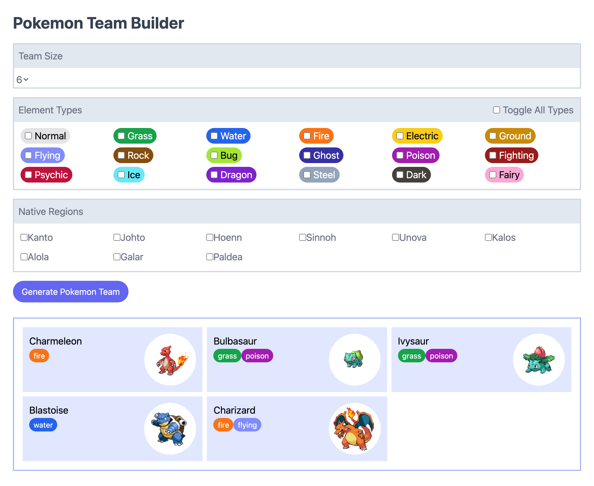

# Pokémon Team Builder

Builds a random Pokémon team from [PokéAPI](https://pokeapi.co/): choose a team size of two to six and the element types you want, then generate a team with sprites and type pills, skipping any duplicate picks. A first project in Vue 3, TypeScript and Pinia, styled with Tailwind CSS and built with Vite; a Pinia store fetches and keeps the Pokémon data so each team is drawn from it without refetching. It's unfinished: it loads only the first nine Pokémon so far, and the region checkboxes aren't wired up yet.

A pre-AI project from 2023.

## Run it locally

1. `npm ci`
2. `npm run dev`, then open the local URL Vite prints
